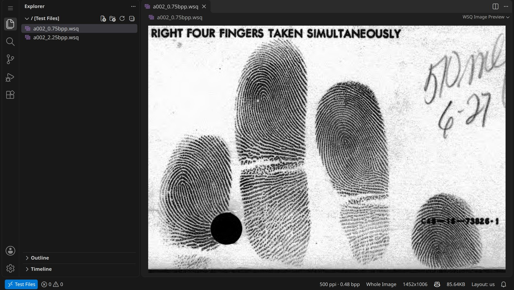
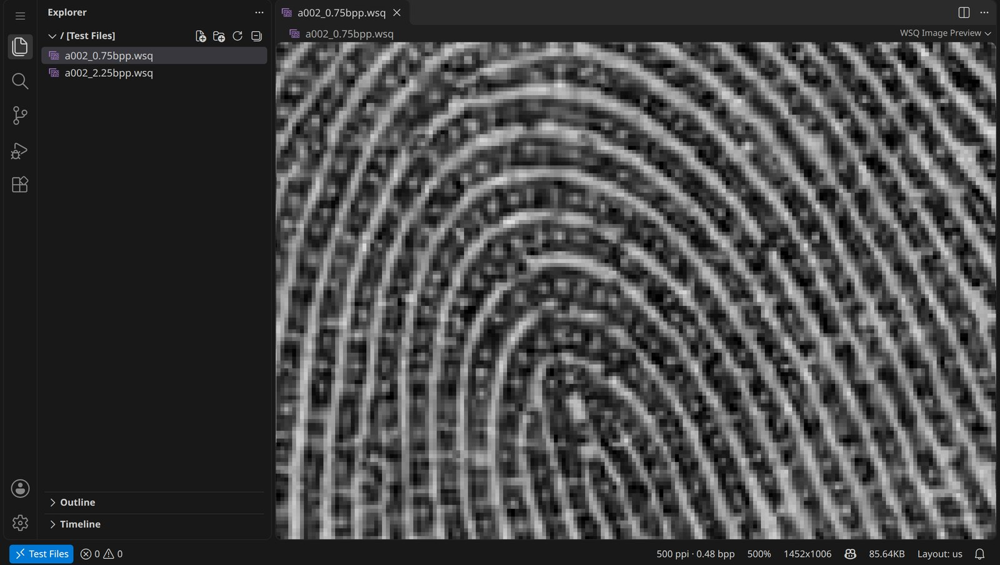
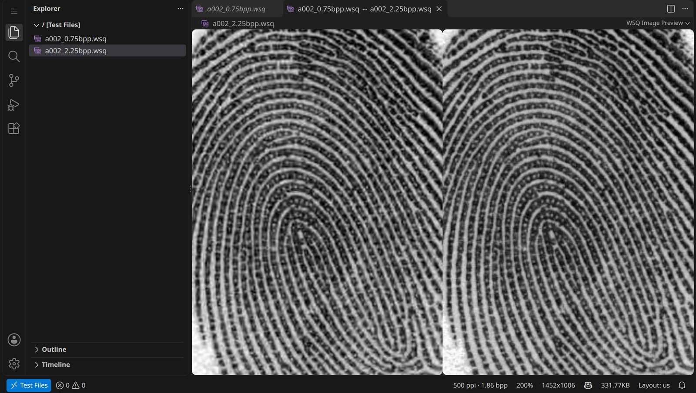

<p align="center">
  
</p>

<h1 align="center">WSQ Viewer</h1>

<p align="center">
  WSQ fingerprint images in Visual Studio Code, opened like PNG and JPEG.<br>
  Powered by a WSQ codec in Rust and WebAssembly that reproduces the NIST reference implementation bit for bit.
</p>

<p align="center">
  <a href="https://github.com/JF235/wsq-viewer/actions/workflows/ci.yml"></a>
  <a href="https://github.com/JF235/wsq-viewer/releases/latest"></a>
  <a href="LICENSE"></a>
</p>



WSQ (Wavelet Scalar Quantization, FBI specification IAFIS-IC-0110 v3.1) is the compression format
of fingerprint images at 500 ppi. This repository holds a VS Code extension that shows WSQ files
as images, the codec behind it, and two documents: a didactic description of the algorithm and a
report on how the codec was made fast.

## The extension

Install it from the [releases](https://github.com/JF235/wsq-viewer/releases/latest)
(`code --install-extension wsq-viewer-1.0.0.vsix`) or, once published, from the Visual Studio
Marketplace (search for "WSQ Viewer"). Then click a `.wsq` file.

| | |
|---|---|
|  |  |
| **Zoom** like the image preview: click, Ctrl+click, Ctrl+wheel, pinch; square pixels beyond 300% | **Diffs** of `.wsq` files side by side (here 0.75 against 2.25 bits per pixel, at 200%) |

- Status bar with zoom, dimensions, file size, resolution and bit rate; the header and the NISTCOM
  fields in its tooltip.
- **Export as PNG** (the resolution goes into the PNG), **Show Image Information**, **Select Zoom
  Level**; copy the image with Ctrl+C.
- A file icon for `.wsq` files in the Explorer.
- Exact NBIS pixels by default; `wsqViewer.decodeMode: fast` is a few percent faster, within the
  tolerances of the specification.
- Desktop, remote workspaces and vscode.dev, also in restricted mode. Images never leave the machine.

More in the [extension's README](extension/README.md) and its [changelog](extension/CHANGELOG.md).

## The codec

`crates/wsq` is a WSQ decoder and encoder in Rust, without dependencies.

- **Exact mode** reproduces NBIS 5.0.0, the NIST reference implementation, bit for bit: the decoder
  returns the pixels of `dwsq` on the 86 decoder files of the NIST reference set (filter banks 9/7,
  10/10, 6/10 and 9/11), and the encoder writes the bytes of `cwsq` on its 40 images at 0.75 and 2.25
  bits per pixel, NISTCOM comment included; checked on every instruction set, with 1 and 4 threads.
- **Fast mode** reorders and fuses the arithmetic and stays within the compliance tolerances of the
  specification (Annex AA).
- Kernels are written once over a small vector interface; backends implement it for scalar code,
  SSE2, AVX2 with FMA, AVX-512F and WebAssembly SIMD, and the widest one available is picked at run
  time. Decoding can split large images across threads.

Image `a002` of the NIST set (1452 × 1006, a four-finger slap) at 0.75 bits per pixel, one core of
an Intel Core i5-12450H, median times:

| | decode | | encode | |
|---|---:|---:|---:|---:|
| NBIS 5.0.0 (C) | 52.4 ms | 1× | 36.7 ms | 1× |
| this codec, AVX2, exact | 4.8 ms | 10.9× | 6.9 ms | 5.3× |
| this codec, AVX2, exact, 4 threads | 2.7 ms | 19.7× | | |
| WebAssembly with SIMD (Node.js), exact | 6.5 ms | 8.1× | | |

Over the 40 images of the set, decoding is 11.8 times faster than NBIS and encoding 4.5 to 5.8
times. The [performance report](docs/performance) has the method, every optimization and its
gain, the cost of exactness, AVX-512 on a server and a test of batch decoding on a GPU.

`crates/wsq-cli` is a command-line tool (`wsq decode`, `encode`, `info`, `bench`, `backends`);
`crates/wsq-wasm` is the WebAssembly interface the extension uses.

## Documents

Both are LaTeX sources in this repository; the PDFs are attached to each
[release](https://github.com/JF235/wsq-viewer/releases/latest).

- [The WSQ Fingerprint Image Compression Algorithm](docs/algorithm): the wavelet transform and its
  64 subbands, the quantizer, the Huffman coding and the file format, with figures and pseudocode.
- [Making WSQ Fast](docs/performance): optimizations, exactness and backends of this codec,
  measured against NBIS.

## Building and testing

```sh
cargo build --release                     # the codec and target/release/wsq
cargo test --release                      # unit, round-trip and robustness tests
WSQ_NIST_DIR=<reference_images_v2.0_pgm> cargo test --release   # plus the NIST conformance tests

cd extension
npm ci
npm run build:wasm                        # needs: rustup target add wasm32-unknown-unknown
npm test                                  # type checks, unit tests, VS Code for the web in headless Chromium
npm run package                           # wsq-viewer-<version>.vsix
```

The conformance tests read the [NIST WSQ reference images, version 2.0](https://nigos.nist.gov/wsq/reference_images_v2.0_pgm.tar)
(PGM edition); without `WSQ_NIST_DIR` they are skipped. The data set is not in this repository;
the figures and screenshots use its image `a002`.

| Path | Content |
|---|---|
| `crates/wsq` | the codec (library) |
| `crates/wsq-cli` | the `wsq` command-line tool |
| `crates/wsq-wasm` | the WebAssembly interface |
| `extension` | the VS Code extension |
| `bench` | the benchmarks of the performance report (NBIS harness, WebAssembly in Node.js) |
| `docs/algorithm`, `docs/performance` | the two documents |

## License

[MIT](LICENSE).
