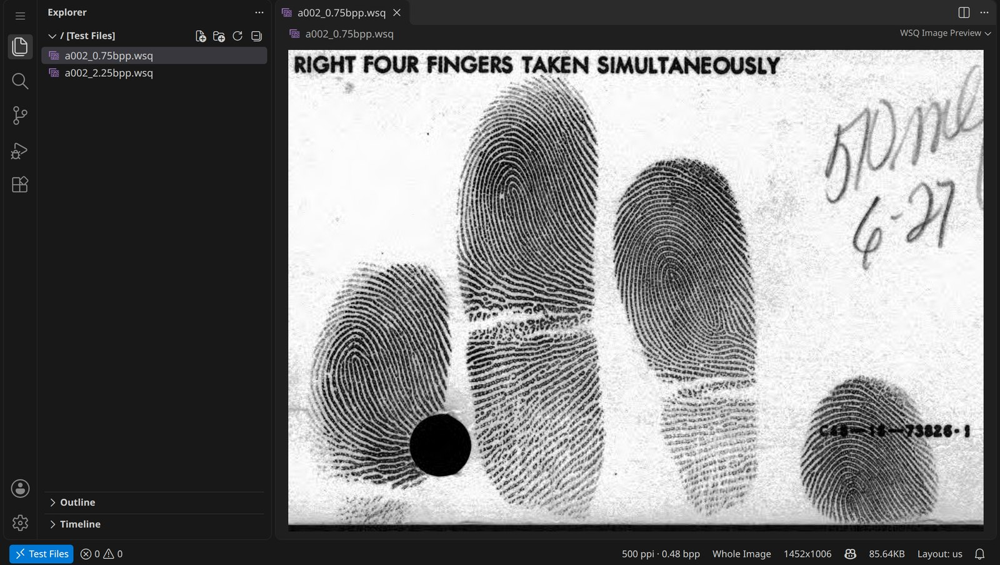
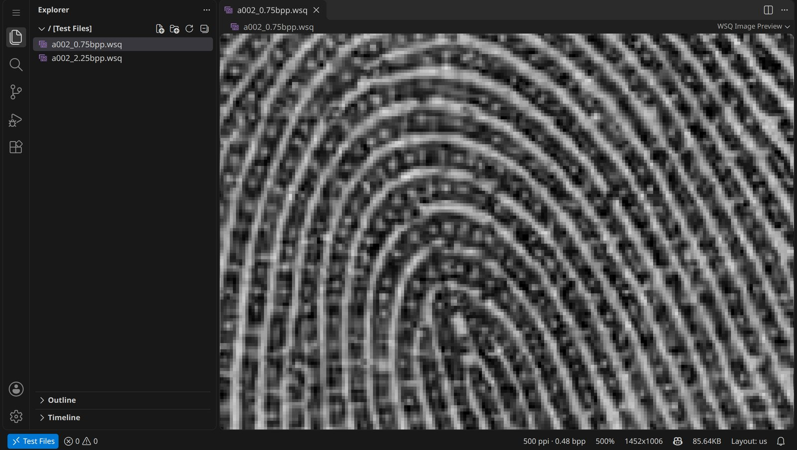
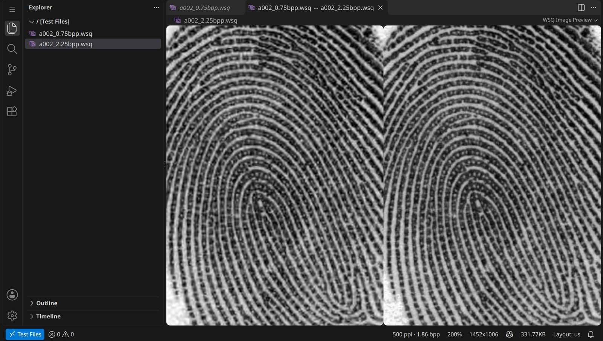
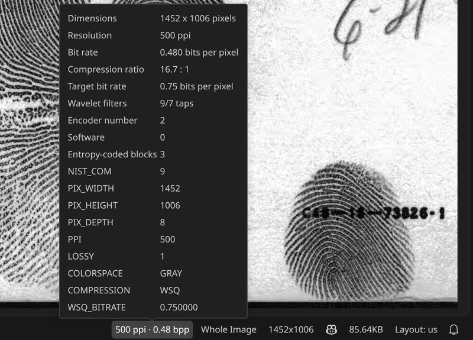

  

<h1 align="center">WSQ Viewer</h1>

  Open WSQ fingerprint images in Visual Studio Code the way PNG and JPEG files open: 
  click a <code>.wsq</code> file and the image appears.

WSQ (Wavelet Scalar Quantization, FBI specification IAFIS-IC-0110 v3.1) is the compression format
of fingerprint images at 500 ppi. The decoder ships inside the extension; there is nothing else to
install.

## Features

**Behaves like the built-in image preview.** The image opens scaled to fit. Click to zoom in,
Ctrl+click (Alt+click on macOS) to zoom out, Ctrl+wheel or pinch to zoom smoothly; beyond 300% the
pixels are drawn as squares. Zoom and scroll position are kept when you switch tabs or open the
image again. Ctrl+C copies the image.

**Diffs side by side.** A changed `.wsq` file in source control, or two files compared with
*Compare Selected*, shows both images next to each other; each side zooms on its own.

**Status bar and image information.** Zoom (click it to pick a level), dimensions, file size, and
the resolution and bit rate of the file. Its tooltip, and the command *WSQ: Show Image Information*,
list the header: dimensions, resolution, bit rate, compression ratio, wavelet filters and every
NISTCOM field.

**And also**

- *WSQ: Export as PNG*, from the editor, the Explorer's context menu or the Command Palette; the
  resolution goes into the PNG file.
- A file icon for `.wsq` files in the Explorer, in the style of the default icon theme's image icons.
- Reloads when the file changes on disk; shows a clear message for damaged files and Git LFS
  pointers.
- Works in VS Code for the desktop, in remote workspaces and in vscode.dev, also in restricted mode.

## Settings

| Setting | Default | |
|---|---|---|
| `wsqViewer.decodeMode` | `exact` | `exact`: the pixels of the NIST reference decoder (NBIS 5.0.0), bit for bit. `fast`: a few percent faster, within the tolerances of the specification (at least 99.9% of the pixels equal to the reference decoder, none off by more than one grey level). |

The editor follows `workbench.editor.restoreViewState` for remembering zoom and scroll.

## Commands

| Command | |
|---|---|
| WSQ: Zoom In / Zoom Out | one zoom level up or down |
| WSQ: Select Zoom Level | 20% to 1000%, or the whole image |
| WSQ: Export as PNG... | save the decoded image as PNG |
| WSQ: Show Image Information | the header fields; pick one to copy its value |
| WSQ: Copy Image | from the image's context menu (also Ctrl+C) |

## Decoder

A Rust implementation of the WSQ specification compiled to WebAssembly, with SIMD where the engine
supports it. It decodes a 1452 × 1006 image in 6 to 8 ms and, in its default mode, returns exactly
the pixels of the NIST reference decoder, as checked on the whole NIST compliance data set. Images
are decoded locally and never leave your machine.

Source, a description of the algorithm and performance measurements:
<https://github.com/JF235/wsq-viewer>. License: MIT.
